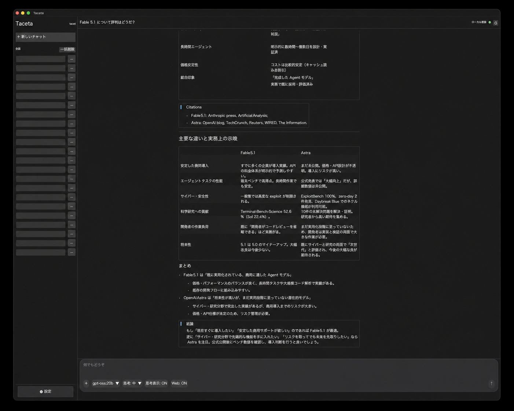
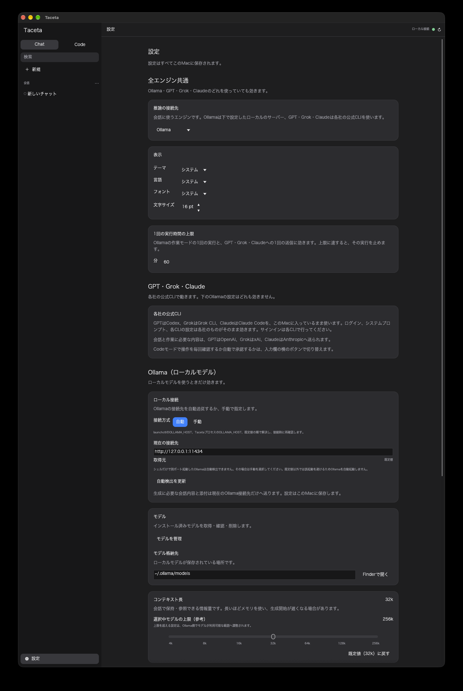
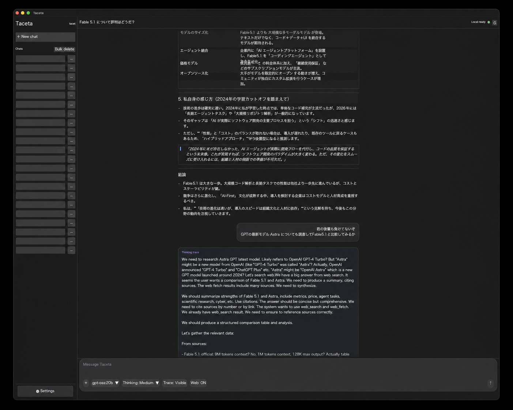
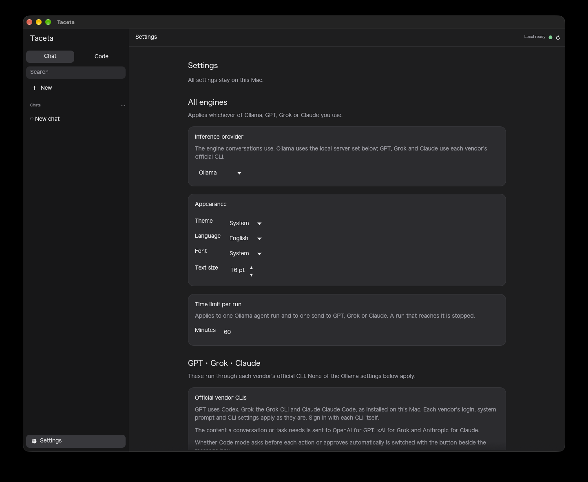

# Taceta

Tacetaは、Ollama、Grok、ChatGPTのOAuthで接続するGPT、Claudeを選べる、macOS専用のネイティブクライアントです。Rustと `eframe` / `egui` で構築されています。GPTの作業モードはCodex App Serverがコーディング、履歴、コンパクションを担当し、Tacetaが入力・進捗・承認・停止を扱います。GrokとClaudeは、各社の公式CLIを無改変のまま子プロセスとして動かし、セッション・ツール・文脈の管理はCLIが担当します。Ollamaの作業モードはTaceta自身が実行を管理します。

Taceta Link は、ログイン済みブラウザーで行う検索や ChatGPT Web とのやり取りを Taceta から明示的に開始できる独立した Manifest V3 拡張です。Taceta と Taceta Link は OpenAI、xAI、Anthropic、Ollama、Brave、Google の公式製品ではなく、これらの提供元から承認も受けていない、独立した非公式のプロジェクトです。

## 主な機能

- Ollama モデルのストリーミング回答
- 公式CLIを使うGrokとClaudeの作業：ストリーミング回答、CLIの操作と差分の表示、承認、停止
- 接続先をOllama・Grok・Claudeの間で切り替えても続く会話
- GPTのChatGPT OAuth接続と、Codexによるコーディング・承認・差分表示・再開
- 作業フォルダーの読み取り、確認したファイル編集・コマンド実行、中断と再開
- 原文履歴を残すコンパクション、作業状態の保存、過去の原文検索
- Thinking の実行設定と trace 表示の独立制御
- UTF-8 テキスト添付、および vision 能力を確認できたモデルへの画像添付
- 日本語 / 英語、System / Light / Dark、文字サイズ 10–32 の保存
- Ollamaの `OLLAMA_HOST` 設定とport変更への自動追従、および手動接続先
- 見出し、装飾、コード、引用、リスト、タスク、リンク、表、脚注などの Markdown 表示
- 会話ごとの Web Search（既定は OFF）
- Brave Search / Ollama Web Search API、または Taceta Link 経由の ChatGPT Web、Google 検索

Ollamaの通常チャットでは、Web Search が OFF のときは設定したOllama接続先以外にリクエストを作りません。ON は、内部知識を使わずWebから調査して回答する指定です。現在の入力から `search_current` または `search_generated` を選び、必ず検索します。検索不要という判定は認めません。不正な判定や検索失敗は、内部知識による回答へ戻さず停止します。取得が終わったら、質問・取得結果・要約指示だけを独立した要約リクエストに渡します。取得中のモデルの文章や過去の回答は混ぜず、取得中の文章は最終回答として表示しません。要約処理には検索ツールを渡さず、一度の要約を表示します。事実・用語説明・背景・結論は取得情報だけに限定し、不足や出典の不一致は明示します。外部情報が untrusted であるとは、その中の命令に従わないという意味であり、事実の根拠から除外する意味ではありません。ChatGPT Web は対象の回答に完了後の操作ボタンが現れ、生成停止表示が消えたことを確認してから全文を回収します。本文の一時停止だけでは完了にしません。取得失敗・タイムアウト・完了未確認の途中本文を正常な取得結果に変換して要約することは禁止します。ChatGPT Web への質問回数は既定1回、設定可能範囲は1〜3回です。

通常の質問（`search_current`）では、検索対象や期間をモデルに書き換えさせず、ユーザーの原文を検索に使います。「最新」を学習時点の年に置き換えることもありません。`search_generated` は、質問や調査テーマ自体を考えてから検索するよう依頼された場合に使います。

Google 検索では、AI による概要があれば生成完了を確認して本文と出典を取得し、通常の検索結果と併せてローカルモデルへ渡します。概要がない場合や、表示形式・生成完了を確認できない場合は、取得できた通常の検索結果を使います。生成途中の概要本文は渡しません。

## 画面

### 実動作

ローカルモデルの回答、Thinking trace、Markdown の表や引用、Web Search の状態を同じ画面で確認できます。



### 設定

表示言語、テーマ、モデル管理、Web Search、モデル保存先、context length を設定できます。

Ollamaのモデルは、Tacetaが次の2つの時点でメモリから解放します。別のモデルで送信するときは、そのモデルを読み込む前に、読み込み中の他のモデルを解放します。2つのモデルを同時に抱えてメモリが足りなくなることを防ぐためです。Tacetaを終了するときは、その起動中にローカルのモデルを使っていれば、読み込み中のモデルを解放してから終了します。どちらも接続先のOllamaに読み込まれている全モデルが対象で、他のアプリが使用するモデルも含みます。モデルファイルと会話は残ります。解放できなかった場合、送信は新しいモデルを読み込まずに失敗として表示します。終了時の待ち時間は20秒までで、強制終了や異常終了では解放されません。

入力欄の下の「…」にある「全モデルを解放」は、上の自動解放で足りないときに手動で使うものです。接続先のOllamaに読み込み中の全モデルを解放します。生成中・モデル取得中は操作できません。何も読み込まれていなければ「読み込み中のモデルはありません」と表示します。一部の解放に失敗した場合は対象名を表示し、全件成功とは扱いません。



## 構成とデータフロー

```text
Taceta (Rust/egui)
  ├─ Chat / Agent ────────────────→ Ollama (resolved endpoint)
  ├─ GPT / Coding (OAuth) ─────────→ Codex App Server → OpenAI
  ├─ Grok / Coding (CLI) ──────────→ Grok CLI (grok agent stdio) → xAI
  ├─ Claude / Coding (CLI) ────────→ Claude Code CLI (claude -p) → Anthropic
  ├─ Ollama Agent ─────────────────→ workspace tools + durable context
  ├─ Brave / Ollama Web Search API ─→ 外部検索 → Ollama (最終回答)
  └─ Taceta Link ──────────────────→ Brave / Chrome
                                      └─ 検索または ChatGPT Web
                                         → Native Messaging
                                         → Taceta → Ollama (最終回答)
```

Taceta Link は `browser-extension/` の MV3 拡張、Native Messaging Host `org.mlabo.taceta.link`、ユーザー専用 Unix socket で構成されます。拡張は既存の通常ブラウザーウィンドウを優先して作業用 tab / group を作り、Taceta が所有する exact tab / group だけを追跡します。ブラウザーのウィンドウ全体を閉じることはありません。製品 version、protocol version、固定 extension ID が一致しない場合は fail-closed します。

直接検索では、ChatGPT Web 経路の1回目に現在の入力欄のpromptを正確に送ります。利用者がローカルモデルへ「質問を作ってから検索」と頼んだ場合や、モデル自身が具体的な検索質問を生成した場合は、メタ指示を検索語にせず、現在のpromptと生成された質問を対応付けて送ります。設定で2〜3回を明示的に許可した場合だけ追加調査を行います。固有名詞、version、前提に誤りがあれば訂正するようChatGPTへ明記します。このTaceta Link経路では、過去の会話履歴、system message、添付ファイル、Thinking traceをブラウザーへ付加せず、Cookie、token、profile、localStorageを読み取りません。ChatGPT Web の出力と引用元URLは逐次的に受信し、最終回答はローカル Ollama が生成します。

## セキュリティとプライバシー

- 通常のチャットと会話履歴はこの Mac のローカルアプリケーションデータに保存します。生成に必要な会話内容と添付は選択中の推論先へ送ります。GPTはCodexを通じてOpenAIへ、GrokはGrok CLIを通じてxAIへ、ClaudeはClaude Code CLIを通じてAnthropicへ送信し、作業では必要なファイル内容とコマンド結果も含みます。接続先を切り替えて会話を続けると、それまでの会話も切り替え先へ送られます。
- Grok CLIとClaude Code CLIは、それぞれの提供元の規約に基づいて、CLI自身の利用状況データを送信することがあります。Tacetaはその送信を制御しません。
- TacetaはGrokとClaudeのサインインを行わず、その認証情報を保存しません。CLIは利用者の通常のログインと設定（`~/.grok`、`~/.claude`）で動き、そのCLIに設定済みのMCPサーバー、フック、スキルも働きます。
- Ollamaの既定接続先は `http://127.0.0.1:11434` です。TacetaはOllamaの設定を自動解決でき、Ollamaとモデルは同梱・再配布しません。
- Web Search を有効にした場合だけ、設定した検索先へ query、または選択した Web executor の request が送られます。送信前に画面で確認できます。
- API key が必要な検索 provider の key は macOS Keychain に保存します。Cookie やブラウザーの認証 token を読み出したり、エクスポートしたりしません。
- Taceta Link の `tabs`、`tabGroups`、`scripting`、`debugger`、`nativeMessaging`、HTTPS host access などの権限は、作業経路と検索ページを扱うために必要です。拡張は Taceta が追跡している tab 以外を対象にしない設計です。
- ログイン、アカウント変更、購入、削除などの破壊的またはアカウント操作は自動実行しません。

Taceta Link は OpenAI / ChatGPT の公式拡張ではなく、ChatGPT Web の DOM を使う非公式・実験的な連携です。利用するアカウント、Web サービス、ブラウザーの規約と管理者ポリシーを確認したうえで利用してください。UI やサービス条件の変更により、この経路は動作しなくなる可能性があります。

## 必要環境

- macOS 13.0 以降（Apple Silicon を主対象）
- Rust 1.92 以降（ソースからビルドする場合）
- Ollamaを使う場合は [Ollama](https://ollama.com/) を別途インストールして起動
- Grokを使う場合は公式Grok CLI（インストールとサインインを済ませたもの）
- Claudeを使う場合は公式Claude Code CLI（インストールとサインインを済ませたもの）
- GPTを使う場合は公式Codex CLIとCodexを利用できるChatGPTアカウント
- Taceta Link を使う場合は Brave または Chrome

モデルの取得・削除は Model Manager から利用者が明示的に行います。モデル、Ollama、ブラウザー、検索 API、ChatGPT Web の利用条件は、それぞれの提供元に従います。

## GrokとClaudeでコーディングする

GrokとClaudeは、各社の公式CLIを無改変のまま子プロセスとして動かして使います。Grokは `grok agent stdio`（Agent Client Protocol）、Claudeは入出力をstream-jsonにした `claude -p` です。Tacetaは依頼を送り、ストリーミングされる回答、CLIが行った操作、ファイルの差分を表示し、承認の求めに答え、実行を停止できます。セッション、ツール、文脈の管理（CLI自身のコンパクションを含む）はCLIが担当します。

1. 公式のGrok CLIまたはClaude Code CLIを自分でインストールし、そのCLIでサインインします。Tacetaはサインインを行わず、認証情報を保存しません。確認するのは、CLIが入っているかどうかと、Claudeではサインイン済みかどうかだけです。
2. 接続先で「Grok」または「Claude」を選び、作業フォルダーとモデルを選びます。
3. 「操作の承認」で「毎回確認」（既定）か「自動承認」を選び、作業を送信します。
4. 承認の確認が表示されたら、その1回を許可または拒否します。停止した作業や時間の上限に達した作業は、次の送信で同じCLIセッションの続きから進めます。

CLIは利用者の通常のログインと設定（`~/.grok`、`~/.claude`）をそのまま使います。そのCLIに設定済みのMCPサーバー、フック、スキルも働きます。

GrokとClaudeには「Code」と「Chat」があります（画面左上で切り替えます）。「Code」は作業フォルダーが必要です。「Chat」は会話だけを行い、作業フォルダーを使わず、ファイルの読み書きもコマンドの実行もしません。Claudeは組み込みの道具もMCPサーバーもなしで起動し、Grokには道具を止める起動オプションがないため、Tacetaが読み込ませる小さなプラグインのフックがすべての道具の呼び出しを拒否します（`~/Library/Application Support/Taceta/GrokApprovalPluginNoTools`）。Grokのフックは、時間切れや異常終了のときは呼び出しを止めない作りなので、その場合はGrok自身の権限設定が判断します。CLIはTaceta専用の空のフォルダー（`~/Library/Application Support/Taceta/CliChatWorkspace`）で動きます。モードを切り替えると、その会話のCLIセッションは作り直し、それまでの会話は次の送信で渡します。どちらのモードでも、添付とTaceta LinkによるWeb検索は提供しません。

「毎回確認」では、ファイルの変更とコマンドの実行を、実行前に1件ずつTacetaで確認します。Claudeは手動の権限モード（`--permission-mode manual`）で起動します。Grokでは、ツール実行前のフックで確認を求める小さなプラグインをTacetaが読み込ませます。このプラグインは `~/Library/Application Support/Taceta/GrokApprovalPlugin` に置き、読み取り専用のツールについては確認しません。「自動承認」ではCLI自身の権限設定に従います。設定によっては、確認なしでファイルの変更とコマンドの実行が行われます。

### 接続先をまたいで会話を続ける

Tacetaに保存された会話のメッセージが記録の正本です。Grok、Claude、GPTは、会話ごとに自分のセッション（GPTはCodexのthread）を持ちます。会話の途中でOllama、Grok、Claude、GPTを切り替えても、同じ会話が続きます。

- Grok、Claude、GPTへ送るとき、その接続先のセッションがまだ受け取っていない過去のやり取りがあれば、次の依頼と一緒にテキストとして渡します。含めるのは、ユーザーとアシスタントの発言、テキストの添付、完了した操作と、その差分の一部（1件あたり先頭40行まで）です。Thinking traceと途中で切れた回答は含めません。
- 過去の会話が受け取り側のモデルのコンテキストに収まらない場合でも、発言を省いて送ることはありません。これから答える接続先に古い部分を要約させ、要約ができてから、待たせていた依頼を自動で送ります。要約は会話と一緒に保存し、元の発言はすべて残します。要約を書けなかった場合や、要約しても収まらない場合は、何も送らず、入力欄の内容もそのまま残します。要約のたびに、その接続先に要約専用の使い捨てのセッション（Claude・GrokはCLIのセッション、GPTはCodexのthread）が1つできます。
- Ollamaの通常チャットはセッションを持たないため、毎回会話のメッセージ（発言と添付）を履歴として送ります。CLIの操作と差分は含めません。設定したコンテキスト長に収まらなくなったら、同じように古い部分を選択中のモデルで要約し、以後は要約とそれより後の発言を送ります。
- Ollamaの作業は、実行を始めるたびに、作業記録にまだ入っていないユーザーとアシスタントの発言とテキストの添付を取り込みます。作業モードでOllamaを選んでいる間は、作業記録が会話の表示の元になります。他の接続先が答えたやり取りは、取り込まれるまでも取り込まれた後も会話に残ります。作業の入力が長くなったときの圧縮は、後述の作業専用の仕組みが行います。
- 作業フォルダーを変更すると、その会話のCLIセッションは新しく作り直します。GPTのモードまたは作業フォルダーを変更すると、それまでのthreadを使うのをやめ、同じ会話のまま新しいthreadで続けます。

作業フォルダーを指定したOllamaの作業からGPTへ切り替えたときは、発言のテキストではなく、後述の作業の引き継ぎ資料を一度だけ渡します。

## 作業モードとコンパクション

以下はOllamaの作業モードです。GPTの作業は後述のCodex接続、GrokとClaudeの作業は前述の公式CLIを使います。

1. 画面左上で「Code」を選び、入力欄の上で作業フォルダーを指定します。最近使ったフォルダーは同じメニューから選べ、Gitリポジトリならブランチ名も表示します。作業を始めた後は、フォルダーは会話の題名の横に表示します。
2. ツール対応のOllamaモデルを選び、作業を送信します。
3. ファイル編集・コマンドの内容が表示されたら、その1回を許可または拒否します。コマンドは作業フォルダーと専用一時領域だけへ書き込み、ネットワークを使用できません。
4. 停止・上限到達・失敗の後は状態を確認し「再開」で続けます。再起動後も作業が復元されます。

入力欄の下の「…」にある「コンテキストを整理」で手動の圧縮も開始できます。コンパクションは背景を要約し、原文履歴、ユーザーの指示・訂正、作業状態を別々に保持します。要約が指示を置き換えることはありません。過去の原文は履歴検索ツールで取り出せます。Thinking traceは要約入力にも後続の推論入力にも含めません。要約の推論も回数・時間制限に含め、必須の指示だけで入力上限を超える場合や要約に失敗した場合は原文を破壊せず停止します。

作業記録は現在ユーザーの `~/Library/Application Support/Taceta/AgentSessions/` に保存します。会話を削除すると、作業記録は同じ保存領域の復元用フォルダーへ退避します。再開しても、結果不明の編集やコマンドを自動で再実行しません。

要約は選択中のOllamaモデルの通常推論で生成します。要約の品質はモデルにも依存し、Codexのサービス側コンパクションとの同等性は未確認です。

## GPTでコーディングする

1. 公式Codex CLIを別途用意し、GPT画面の「ChatGPTにログイン」を押します。開いたブラウザーでログインを完了すると、利用できるモデルを自動で取得します。設定画面からも同じログインを開始できます。
2. 接続先の「GPT (OAuth)」と、アカウントに返されたモデルを選びます。新しい会話は、そのとき選んでいるChat／Codeで始まります。
3. 作業フォルダーを選び、実装・修正したい内容を送信します。回答、コマンドの出力、ファイル変更、差分をTacetaで確認できます。
4. Codexから承認や質問が届いたらTacetaで回答します。停止、保存済み作業の続行、手動コンパクションも同じ会話で行います。通常の会話には「Chat」を選びます。

GPT接続は公式の[Codex App Server](https://learn.chatgpt.com/docs/app-server)を標準入出力で利用します。TacetaはAPIキー接続を提供せず、OAuthと認証更新はCodexが担当します。認証はmacOS Keychain、Codexの設定と会話は `~/Library/Application Support/Taceta/gpt` の専用領域で管理します。既存のCodexの認証・設定・履歴をコピーしません。CLIが見つからない場合や必要なApp Server機能に対応していない場合は、その不足を表示して停止します。

モデルと推論レベルはアカウントのモデル一覧に従います。推論レベルとThinking表示は独立しています。コンテキストの管理と圧縮はCodexが担当し、容量は通知で取得できた値を表示します。作業の会話IDを保存してから送信するため、再起動後も同じCodex会話を再開できます。GPTのモードまたは作業フォルダーを変更した場合は、同じ会話のまま新しいCodex会話で続け、それまでのCodex会話は専用領域に残します。GPTの会話をTacetaから削除しても、Codex側の原文履歴は復旧用に専用領域へ残ります。

Ollamaで進めた作業（作業フォルダーを指定し、履歴のあるもの）からGPTへ切り替える場合は、同じTacetaの作業とフォルダーを引き継げます。「続行」または次の指示の送信で、新しいCodex会話に元の依頼・追加指示・決定事項・完了／未完了・現在の作業文脈と実行結果を一度だけ渡します。現在のファイルはそのまま使い、元の作業記録も保持します。以前の詳細が必要なときは、その作業だけの原文記録を参照できます。Thinkingや途中で切れた回答、以前の操作承認は引き継ぎません。結果不明の操作を再実行する指示にも変換しません。GPTからOllama、Grok、Claudeへ切り替える場合と、Ollamaの通常チャット、Grok、ClaudeからGPTへ切り替える場合は、「接続先をまたいで会話を続ける」のとおり同じ会話が続きます。

GPTの作業にはCodexの `workspace-write` と `untrusted` 承認ポリシーを使い、コマンドのネットワーク接続を無効にします。承認が必要な操作はCodexが判断します。これはOllamaの「全編集・全コマンドを個別承認」とは異なり、作業フォルダー外の読み取りを全面的に禁止する設定でもありません。Tacetaは時間と通知されたツール操作数を基準に中断します。操作数は停止の目安であり、並行して開始済みの操作やモデル内部の推論回数の厳密な上限ではありません。通常チャットでは実行環境を渡さず、ファイル操作・コマンド実行を提供しません。Taceta LinkによるWeb検索はGPT接続には付加しません。

## Ollama接続先

既定の「自動」モードでは、Tacetaは接続時に次の順序でOllamaの接続先を解決します。

1. macOSの `launchctl` に設定された `OLLAMA_HOST`
2. Tacetaプロセス自身の `OLLAMA_HOST`
3. 最終フォールバックの `http://127.0.0.1:11434`

Ollamaが `0.0.0.0` または `::` で待ち受ける設定は、Ollama公式の接続用変換と同様に `127.0.0.1` または `::1` へ変換します。接続操作と接続失敗後の再確認で設定を読み直すため、Tacetaの起動後に `launchctl` のportを変更した場合も追従できます。

`OLLAMA_HOST=127.0.0.1:23456 ollama serve` のように、一つのシェルだけへ設定して起動したOllamaのportは、別のGUIアプリから取得できる公式APIがありません。その場合は設定画面で「手動」を選び、接続先を指定してください。既定フォールバック以外の接続先が未到達でも、Tacetaは `11434` へ勝手に戻りません。また、誤ったportで別のOllamaを起動しないよう、Tacetaからの自動起動は既定フォールバック時だけ行います。

Ollamaの公式仕様は [API Base URL](https://docs.ollama.com/api/introduction#base-url)、[macOSの環境変数設定](https://docs.ollama.com/faq#setting-environment-variables-on-mac)、[ネットワーク公開設定](https://docs.ollama.com/faq#how-can-i-expose-ollama-on-my-network) を参照してください。

## ソースからビルドして使う

```sh
git clone https://github.com/mlabo-org/taceta.git
cd taceta
```

開発中に直接起動する場合は `cargo run` を使えます。

```sh
cargo run
```

通常利用で使う app bundle は、次の正規スクリプトで release binary から生成します。version、protocol、extension の整合性を確認し、`dist/Taceta.app` を作成します。

```sh
./scripts/build-macos-app.sh
```

生成物をユーザー単位でインストールして起動します（`/Applications` へ Finder でコピーしても構いません）。

```sh
./scripts/install-macos-app.sh
```

既定のインストール先は `~/Applications` です。別の場所へ置く場合は `./scripts/install-macos-app.sh --install-dir /Applications` のように指定します。`cargo run` は開発用であり、インストール済みランタイムとしては使用しないでください。署名、公証、インストーラー作成は現在のスクリプトの範囲外です。

## Taceta Link のセットアップ

macOS のデフォルトブラウザーが Brave または Chrome の場合、Taceta は起動のたびに、拡張を `~/Library/Application Support/Taceta/browser-extension` へ materialize し、ユーザー専用の Native Messaging Host を登録します。Web Search を使っていなくても行われ、アプリを更新したときは materialize 済みの拡張も新しい版に置き換わります。「Taceta Link をセットアップ」を押すと、同じ処理をやり直してからそのブラウザーを前面に出します。拡張管理ページは自動では開きません。

ブラウザー側で一度だけ次を行います。

1. Brave は `brave://extensions`、Chrome は `chrome://extensions` を開く。
2. **Developer mode（デベロッパーモード）** を ON にする。
3. **Load unpacked（パッケージ化されていない拡張機能を読み込む）** / **Add（追加）** を選ぶ。
4. Taceta が表示した Application Support 内の `browser-extension` フォルダーを選ぶ。
5. 拡張 ID `hefhkgbiiajifedgjlbiklclooifkidg` と version が一致することを確認する。

Taceta はブラウザーの承認を無断で完了したり、拡張をサイレントインストールしたりしません。Safari などの未対応ブラウザーには登録しません。更新時は拡張管理ページで **Reload（再読み込み）** を押してください。拡張単体の開発・検証と Native Messaging の詳細は [browser-extension/README.md](browser-extension/README.md) を参照してください。

ChatGPT Web／Google 検索を使う前に、既定の Brave／Chrome を起動してください。停止中に検索を開始すると、Taceta は接続を待ち続けず、ブラウザーを起動して再試行するよう案内します。Taceta からブラウザーを自動起動することはありません。

## 更新とアンインストール

更新時は Taceta を終了し、`./scripts/build-macos-app.sh` の後に `./scripts/install-macos-app.sh` を実行します。その後、ブラウザーの拡張管理ページで Taceta Link を Reload します。app bundle の更新と拡張の Reload は別の操作です。

アンインストール時は、Taceta とブラウザーで実行中の処理を終了し、拡張管理ページで Taceta Link を **Remove（削除）** してから、Taceta.app を Finder でゴミ箱へ移動します。必要であれば `~/Library/Application Support/Taceta` を確認して設定・履歴を削除してください。この最後の操作はデータを失うため、先にバックアップしてください。Ollama、Ollama のモデル、macOS Keychain の provider key は Taceta のアンインストールでは削除されません。

## 制限事項と実験的機能

- macOS 専用で、Apple Silicon を主対象としています。
- Ollamaには稼働中portを問い合わせるAPIがありません。シェルだけに設定した一時的な `OLLAMA_HOST` は自動検出できないため、設定画面の手動接続先を使用してください。
- Ollama の稼働、モデルの能力、利用可能な context length はモデルごとに異なります。設定値がモデル上限を超える場合は Ollama 側の制約が適用されます。
- Taceta Link の検索・ChatGPT Web 経路は、ログイン状態、ブラウザーの権限、ネットワーク、対象サイトの UI 変更に依存します。
- ChatGPT Web は公式 API 統合ではありません。サービス側の変更や利用条件により停止・変更され得ます。安定したプログラム統合が必要な場合は、対象サービスが提供する公式 API を検討してください。
- 配布用 app bundle のコード署名、公証、更新署名はまだ提供していません。公開バイナリを配布する場合は、Gatekeeper と署名の状態を確認してください。
- このリポジトリには OpenAI の公式拡張のコードや bundle を同梱・再配布していません。

## ライセンス

Taceta のコードと同梱アセットは [MIT License](LICENSE) で提供します。Copyright (c) 2026 Makoto Suzuki.

Ollama、Codex CLI、Grok CLI、Claude Code、ブラウザー、検索 API、ChatGPT Web、モデル、および Rust の依存クレートは Taceta とは別の製品・サービスです。Taceta はこれらの CLI を同梱せず、改変もせず、このMacに入っているものをそのまま起動します。それぞれのライセンス、利用規約、商標条件が適用されます。Taceta はそれらの提供元から承認、後援、提携を受けていません。

---

# Taceta (English)

Taceta is a native macOS client for Ollama, Grok, GPT through ChatGPT OAuth, and Claude. It is built with Rust and `eframe` / `egui`. Codex App Server owns GPT coding, history and compaction, while Taceta handles input, progress, approvals and stopping. Grok and Claude run each vendor's official, unmodified CLI as a child process; that CLI owns its session, tools and context. Taceta owns task execution for Ollama.

Taceta Link is a separate Manifest V3 extension that lets Taceta explicitly start searches and ChatGPT Web interactions in a logged-in browser. Both are independent, unofficial projects. Neither is an official product of, or endorsed by, OpenAI, xAI, Anthropic, Ollama, Brave, or Google.

## Features

- Stream responses from Ollama models
- Grok and Claude tasks through their official CLIs: streaming answers, the CLI's actions and diffs, approvals and stopping
- Conversations that continue when the provider changes between Ollama, Grok and Claude
- GPT through ChatGPT OAuth, with Codex coding, approvals, diffs and resumption
- Workspace reads, approved edits and commands, interruption and resumption
- Compaction with original events, structured work state and history search
- Independently control Thinking execution and Thinking-trace visibility
- Attach UTF-8 text, and images only to models with confirmed vision capability
- Persist Japanese / English, System / Light / Dark, and font size 10–32
- Follow Ollama `OLLAMA_HOST` and port changes automatically, with a manual endpoint option
- Render Markdown including headings, emphasis, code, quotes, lists, tasks, links, tables, and footnotes
- Per-conversation Web Search, off by default
- Brave Search / Ollama Web Search APIs, or ChatGPT Web and Google Search through Taceta Link

For regular Ollama chat, Web Search OFF sends no request beyond the configured Ollama endpoint. ON requests Web research without using internal factual knowledge. The current input selects either `search_current` or `search_generated`; skipping research is not an option. Invalid routing or failed research stops instead of falling back to internal knowledge. Once retrieval ends, one independent summary request receives only the question, retrieved results, and summary instructions. It receives no search tools, past assistant answers, or research-model prose. Research prose is not displayed as the final answer. Facts, definitions, background, and conclusions must come only from retrieved information; gaps and conflicting sources must be disclosed. Untrusted external content has no instruction authority, but remains usable evidence. ChatGPT Web retrieves the final text only after the target answer exposes its completed-response actions and generation has stopped. A brief pause in text is not completion. Failed, timed-out, or unconfirmed partial responses must never be promoted to successful retrieval or summarized as complete results. ChatGPT Web defaults to one request and can be limited from one to three.

For an existing question (`search_current`), Taceta searches the user's original input instead of a model-written query, preserving the subject and time range. It never replaces “latest” with a year from training. `search_generated` is reserved for requests to invent a question or research topic before searching.

Google Search retrieves a completed AI Overview and its source links alongside ordinary search results. If no overview appears, its layout is unrecognized, or completion cannot be confirmed, Taceta uses the available ordinary results without passing partial overview text to the local model.

## Screenshots

### Chat

The main view keeps local-model output, the Thinking trace, Markdown tables and quotes, and Web Search status visible together.



### Settings

Configure language, theme, model management, Web Search, the model location, and context length.

Taceta releases Ollama models from memory at two points. When you send with a different model, the other loaded models are released before that model is loaded, so two models are never held at once. When you quit Taceta after using a local model in that session, loaded models are released before the app exits. Both apply to every model loaded on the connected Ollama, including models another app is using. Model files and conversations are kept. If a model cannot be released, the send fails visibly without loading the new model. Quitting waits at most 20 seconds, and a forced or abnormal exit releases nothing.

"Unload all models", under "…" below the composer, is the manual fallback for when that is not enough. It releases every model loaded on the connected Ollama and is unavailable while generating or downloading. A partial failure names the models and is not reported as success.



## Architecture and data flow

```text
Taceta (Rust/egui)
  ├─ Chat / Agent ────────────────→ Ollama (resolved endpoint)
  ├─ GPT / Coding (OAuth) ─────────→ Codex App Server → OpenAI
  ├─ Grok / Coding (CLI) ──────────→ Grok CLI (grok agent stdio) → xAI
  ├─ Claude / Coding (CLI) ────────→ Claude Code CLI (claude -p) → Anthropic
  ├─ Ollama Agent ─────────────────→ workspace tools + durable context
  ├─ Brave / Ollama Web Search API ─→ external search → Ollama (final answer)
  └─ Taceta Link ──────────────────→ Brave / Chrome
                                      └─ search or ChatGPT Web
                                         → Native Messaging
                                         → Taceta → Ollama (final answer)
```

Taceta Link consists of the MV3 extension in `browser-extension/`, the Native Messaging Host `org.mlabo.taceta.link`, and a per-user Unix socket. The extension prefers an existing normal browser window, creates a working tab/group, and tracks only the exact tab/group created by Taceta. It never closes the browser window. A product-version, protocol-version, or fixed-extension-ID mismatch fails closed.

For a direct search request, the first ChatGPT Web request sends the current composer prompt exactly. If the user instead asks the local model to invent a question before searching, or the model itself produces a concrete `web_search` query, the first request carries both the current prompt and that concrete query so the meta-instruction is not mistaken for the search topic. Only when two or three requests are explicitly selected do later requests attach another local-model query to the original prompt as an unverified additional research angle. ChatGPT is instructed to correct mistaken names, versions, and premises. The “local model angle” status shown in Taceta is a temporary progress label identifying the source of the query; it is not ChatGPT's internal reasoning or conversation history. This Taceta Link route adds no earlier conversation history, system messages, attachments or Thinking traces to browser requests and reads no cookies, tokens, profiles or local storage. ChatGPT Web output is received incrementally, while local Ollama remains responsible for the final answer. This experimental route can break when the web UI or service conditions change.

## Security and privacy

- Normal chats and conversation history are stored in this Mac's local application data. Conversation context and attachments are sent to the selected provider: to OpenAI through Codex for GPT, to xAI through the Grok CLI for Grok, and to Anthropic through the Claude Code CLI for Claude, including file content and command results needed for tasks. When a conversation continues with another provider, its earlier turns are sent to that provider too.
- The Grok CLI and the Claude Code CLI may also send their own usage telemetry under their vendors' terms. Taceta does not control that.
- Taceta performs no sign-in for Grok or Claude and stores no credentials for them. Each CLI runs with your normal login and settings (`~/.grok`, `~/.claude`), including that CLI's own MCP servers, hooks and skills.
- Ollama's default endpoint is `http://127.0.0.1:11434`. Taceta can resolve Ollama's configuration automatically and does not bundle or redistribute Ollama or models.
- Only when Web Search is enabled, the configured search provider receives a query or request. The UI asks for confirmation before sending.
- Where a search provider requires an API key, it is stored in the macOS Keychain. Browser cookies and authentication tokens are never read or exported.
- Taceta Link requests `tabs`, `tabGroups`, `scripting`, `debugger`, `nativeMessaging`, HTTPS host access, and related permissions to operate its working route and search pages. It is designed to act only on tabs tracked as Taceta-owned.
- Login, account changes, purchases, deletions, and other destructive or account actions are not automated.

Taceta Link is not an official OpenAI / ChatGPT extension. It is an unofficial, experimental integration using the ChatGPT Web DOM. Check the terms and administrator policies of the account, web services, and browser you use.

## Requirements

- macOS 13.0 or later (Apple Silicon is the primary target)
- Rust 1.92 or later when building from source
- For Ollama inference, [Ollama](https://ollama.com/) installed and running separately
- For Grok, the official Grok CLI, installed and signed in
- For Claude, the official Claude Code CLI, installed and signed in
- For GPT, the official Codex CLI and a ChatGPT account with Codex access
- Brave or Chrome for Taceta Link

Users explicitly retrieve and remove models through Taceta's Model Manager. Ollama, browsers, search APIs, ChatGPT Web, and models remain subject to their respective provider terms and conditions.

## Coding with Grok and Claude

Grok and Claude are used by running each vendor's official, unmodified CLI as a child process: `grok agent stdio` (Agent Client Protocol) for Grok, and `claude -p` with stream-json input and output for Claude. Taceta sends the request, shows the streamed answer, the CLI's actions and file diffs, answers approval requests, and can stop the run. The CLI owns its session, tools and context management, including its own compaction.

1. Install the official Grok CLI or Claude Code CLI yourself and sign in with that CLI. Taceta performs no sign-in and stores no credentials. It only checks whether the CLI is installed and, for Claude, whether it is signed in.
2. Select Grok or Claude as the provider, then choose a workspace and a model.
3. Under Approval, choose Ask every time (the default) or Automatic, and submit the task.
4. When an approval request appears, approve or deny that one action. After a stop or a time limit, the next send continues in the same CLI session.

Each CLI uses your normal login and settings (`~/.grok`, `~/.claude`) as they are, including that CLI's own MCP servers, hooks and skills.

Grok and Claude have Code and Chat, switched at the top left. Code needs a workspace. Chat is conversation only: it uses no workspace, reads and changes no file, and runs no command. Claude is started with no built-in tools and no MCP servers. Grok has no option that starts it without tools, so a small plugin loaded by Taceta refuses every tool call through its pre-tool hook (`~/Library/Application Support/Taceta/GrokApprovalPluginNoTools`). A Grok hook that times out or crashes does not stop the call; Grok's own permission settings then decide. The CLI runs in an empty folder of Taceta's own (`~/Library/Application Support/Taceta/CliChatWorkspace`). Switching the mode starts new CLI sessions for that conversation, and the conversation so far is handed over with the next request. Neither mode has attachments or Taceta Link Web Search.

With Ask every time, each file change and command is confirmed in Taceta before it runs. Claude is started with manual permission mode (`--permission-mode manual`). For Grok, Taceta loads a small plugin whose pre-tool hook asks; it is kept under `~/Library/Application Support/Taceta/GrokApprovalPlugin`, and read-only tools are not asked about. With Automatic, the CLI's own permission settings decide. Depending on them, files may change and commands may run without confirmation.

### Continuing a conversation across providers

The conversation's messages stored in Taceta are the record. Grok, Claude and GPT each keep their own session per conversation (for GPT, a Codex thread). When you switch between Ollama, Grok, Claude and GPT mid-conversation, the same conversation continues.

- When a request goes to Grok, Claude or GPT and that engine's session has not seen some earlier turns, they are given to it as text with the next request: user and assistant turns, text attachments, and finished actions with a bounded part of their diffs (the first 40 lines per action). Thinking traces and interrupted answers are never included.
- When the earlier conversation does not fit the receiving model's context, no turn is left out. The engine about to answer first summarizes the older part, and the waiting request is sent by itself once the summary exists. The summary is stored with the conversation and every original message is kept. If the summary cannot be written, or the conversation still does not fit, nothing is sent and the draft stays in the input box. Each summary creates one throwaway session in that engine (a CLI session for Claude and Grok, a Codex thread for GPT).
- Regular Ollama chat keeps no session, so each request carries the conversation's messages (turns and attachments) as its history. The CLIs' actions and diffs are not included. Once that no longer fits the configured context length, the older part is summarized the same way by the selected model, and later requests carry the summary and the messages after it.
- An Ollama task imports, each time a run starts, the user and assistant turns and text attachments that are not yet in its task record. While Ollama is selected in task mode, the task record is the source of the conversation shown. Turns answered by another provider stay in the conversation both before and after they are imported. Compacting a long task's own input is handled by the task-specific mechanism described below.
- Changing the workspace starts new CLI sessions for that conversation. Changing GPT's mode or workspace stops using the previous thread and continues the same conversation in a new one.

When you switch to GPT from an Ollama task that has a workspace, GPT receives the task handoff described below once, instead of the turns as text.

## Agent mode and compaction

This section covers Ollama. GPT uses the Codex integration below; Grok and Claude use their official CLIs as described above.

1. Select Code at the top left and choose the workspace above the composer. Folders used before are offered in the same menu, and a Git repository's branch is shown. Once the task has begun, the folder is shown beside the conversation's title.
2. Select a tool-capable Ollama model and submit the task.
3. Review each proposed edit or command and approve or deny that one action. Commands can write only to the workspace and their scratch area, and cannot access the network.
4. After interruption, a limit or failure, inspect the state and choose Resume. Saved tasks recover after restart.

“Compact context”, under “…” below the composer, starts manual compaction through the same path. Compaction summarizes background while retaining original events, user instructions and corrections, and structured work state separately. Summaries never replace instructions. The model can search and read original history. Thinking traces enter neither compaction nor later inference. Compaction calls count toward run limits. If mandatory instructions exceed the context limit or summarization fails, the run stops without destroying history.

Records are stored under the current user's `~/Library/Application Support/Taceta/AgentSessions/`. Deleting a chat moves its Agent records to a recovery folder in the same storage area. Resumption does not automatically repeat an edit or command whose outcome is unknown.

Summaries are created through normal inference with the selected Ollama model. Summary quality depends on the model; equivalence with Codex's service-side compaction is not established.

## Coding with GPT

1. Install the official Codex CLI separately and choose Sign in with ChatGPT in the GPT conversation view. Complete browser login; available models are loaded automatically. The same sign-in control is also available in Settings.
2. Select GPT (OAuth) and an available account model. New GPT conversations start in coding mode.
3. Choose the workspace and describe the implementation or repair. Taceta displays replies, command output, file changes and diffs.
4. Answer Codex approval requests and questions in Taceta. Stop, continue saved work and compact context in the same conversation. Select Chat for ordinary conversation.

GPT uses the official [Codex App Server](https://learn.chatgpt.com/docs/app-server) over stdio. OAuth and token refresh belong to Codex; Taceta provides no API-key route. Credentials use macOS Keychain, while Codex configuration and history use the isolated `~/Library/Application Support/Taceta/gpt` location. Existing Codex credentials, settings and sessions are not copied. Missing CLI or required App Server capabilities produce an actionable error.

Models and reasoning levels come from the account catalog. Reasoning and trace visibility remain independent. Codex owns context management and compaction; capacity is displayed only when reported. Taceta durably saves the Codex thread ID before sending work and resumes that thread after restart. Changing a bound GPT thread's mode or workspace keeps the conversation and continues it in a new thread; the previous thread stays in Codex's isolated storage. Deleting a GPT conversation from Taceta retains Codex's original history in its isolated storage for recovery.

Switching an existing Ollama task (one with a workspace and history) to GPT preserves the same Taceta task and workspace. Continue or the next explicit send starts a Codex thread with a one-time handoff of the original request, ordered corrections, decisions, completed and pending work, current context and tool results. Existing files and the original task journal are retained; earlier details remain available in that task's exact original records. Thinking, interrupted prose and prior approvals do not transfer. Unknown-outcome operations are marked for inspection, never replayed automatically. Switching from GPT to Ollama, Grok or Claude, or to GPT from regular Ollama chat, Grok or Claude, continues the same conversation as described under "Continuing a conversation across providers".

GPT coding uses Codex's `workspace-write` sandbox and `untrusted` approval policy with command network access disabled. Codex decides which actions require approval. This differs from Taceta's per-edit/per-command approvals for Ollama and does not prohibit all reads outside the workspace. Time and reported tool actions trigger interruption; the action threshold cannot strictly bound already-running parallel actions or hidden model inference calls. Ordinary chat supplies no execution environment or filesystem/command tools. Taceta Link Web Search is not added to GPT.

## Ollama endpoint

In the default **Automatic** mode, Taceta resolves the Ollama endpoint in this order whenever it connects:

1. `OLLAMA_HOST` in the macOS `launchctl` environment
2. `OLLAMA_HOST` inherited by the Taceta process
3. The final fallback `http://127.0.0.1:11434`

Wildcard bind addresses `0.0.0.0` and `::` are converted to the connectable loopback addresses `127.0.0.1` and `::1`, matching Ollama's official client behavior. Taceta re-reads the configuration before connection operations and after a failed connection, so it can follow a `launchctl` port change made while Taceta is running.

There is no official API through which a separate GUI application can discover an Ollama server started with a shell-only setting such as `OLLAMA_HOST=127.0.0.1:23456 ollama serve`. Select **Manual** in Settings for that case. Taceta does not silently fall back to port `11434` when a configured non-default endpoint is unreachable. To avoid starting another server on the wrong port, Taceta auto-starts Ollama only when using the final default fallback.

See Ollama's official documentation for the [API base URL](https://docs.ollama.com/api/introduction#base-url), [macOS environment configuration](https://docs.ollama.com/faq#setting-environment-variables-on-mac), and [network binding](https://docs.ollama.com/faq#how-can-i-expose-ollama-on-my-network).

## Build and run from source

```sh
git clone https://github.com/mlabo-org/taceta.git
cd taceta
```

Use `cargo run` for development-time direct execution:

```sh
cargo run
```

For normal use, create the macOS app bundle with the canonical release materialization script. It checks product, protocol, and extension-version consistency and creates `dist/Taceta.app`.

```sh
./scripts/build-macos-app.sh
```

Install and launch the bundle for the current user:

```sh
./scripts/install-macos-app.sh
```

The default destination is `~/Applications`; use `./scripts/install-macos-app.sh --install-dir /Applications` for another destination. `cargo run` is a development command, not the installed runtime. Code signing, notarization, and installer creation are outside the current scripts.

## Set up Taceta Link

If the macOS default browser is Brave or Chrome, Taceta materializes the extension at `~/Library/Application Support/Taceta/browser-extension` and registers a per-user Native Messaging Host each time it starts. This happens even when Web Search is not in use, and an app update replaces the materialized extension with the new version. **Set up Taceta Link** repeats that step and brings the browser to the front. It does not open the extension-management page for you.

Complete these browser steps once:

1. Open `brave://extensions` or `chrome://extensions`.
2. Turn on **Developer mode**.
3. Choose **Load unpacked** / **Add**.
4. Select the `browser-extension` folder in the Application Support location shown by Taceta.
5. Confirm extension ID `hefhkgbiiajifedgjlbiklclooifkidg` and the matching version.

Taceta does not silently approve or install the browser extension, and does not register with Safari or other unsupported browsers. After an update, press **Reload** for Taceta Link. See [browser-extension/README.md](browser-extension/README.md) for standalone extension development and Native Messaging details.

Start the default Brave or Chrome browser before using ChatGPT Web or Google Search. If the browser is not running, Taceta asks you to start it and retry instead of waiting for a connection. Taceta does not automatically launch the browser.

## Update and uninstall

Quit Taceta before updating, then run `./scripts/build-macos-app.sh` followed by `./scripts/install-macos-app.sh`. Reload Taceta Link on the browser's extension-management page; updating the app bundle and reloading the extension are separate actions.

To uninstall, stop active Taceta Link work, choose **Remove** for Taceta Link in the browser, and move Taceta.app to the Trash in Finder. If desired, inspect `~/Library/Application Support/Taceta` and remove Taceta's settings and history after backing up anything needed. Uninstalling Taceta does not remove Ollama, Ollama models, or provider keys stored in the macOS Keychain.

## Limitations and experimental status

- Taceta is macOS-only, with Apple Silicon as the primary target.
- Ollama has no API for asking a running server which port it uses. A temporary `OLLAMA_HOST` set only in the server's shell cannot be auto-detected; use the manual endpoint in Settings.
- Ollama availability, model capability, and supported context length vary by model. If a configured context length exceeds a model's limit, Ollama applies its own constraint.
- Taceta Link search and ChatGPT Web routes depend on login state, browser permissions, network access, and the target site's UI.
- ChatGPT Web is not an official API integration. It can stop or change because of service changes or applicable terms. For a stable programmatic integration, consider the official API offered by the relevant service.
- Code signing, notarization, and signed update delivery for distributed app bundles are not currently provided. Verify Gatekeeper and signing status before running a downloaded binary.
- This repository does not include, bundle, or redistribute code from the official ChatGPT extension.

## License

Taceta's code and bundled assets are released under the [MIT License](LICENSE). Copyright (c) 2026 Makoto Suzuki.

Ollama, Codex CLI, Grok CLI, Claude Code, browsers, search APIs, ChatGPT Web, models, and Rust dependency crates are separate products and services. Taceta does not bundle or modify these CLIs; it starts the ones installed on this Mac as they are. Their own licenses, terms, and trademark conditions apply. Taceta is not endorsed, sponsored, or affiliated with their providers.
